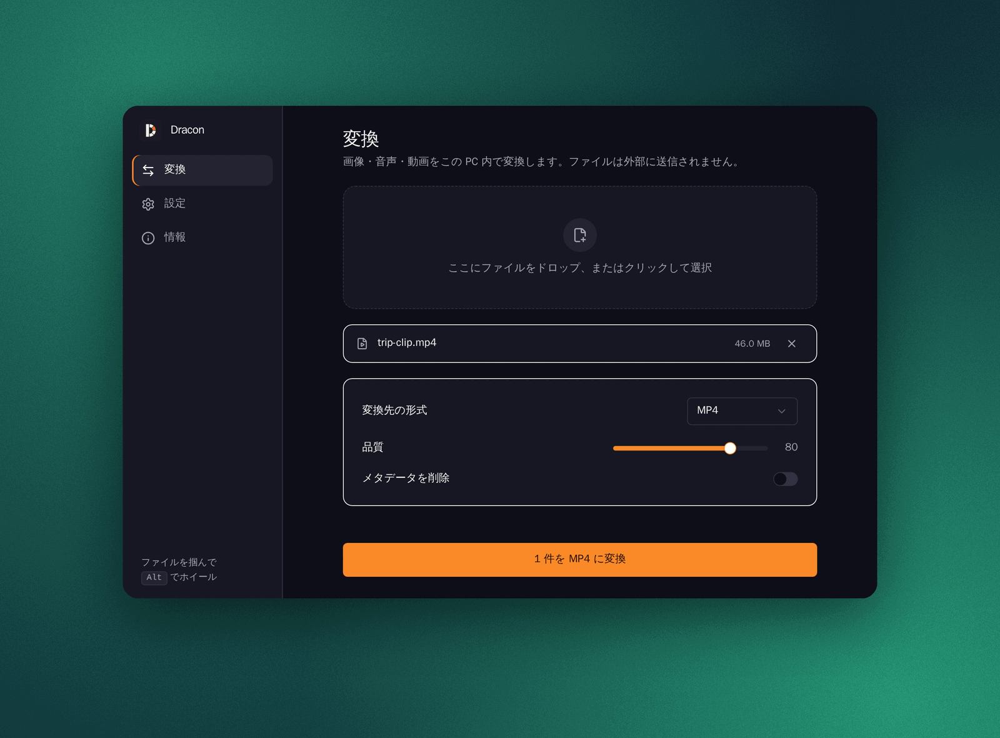
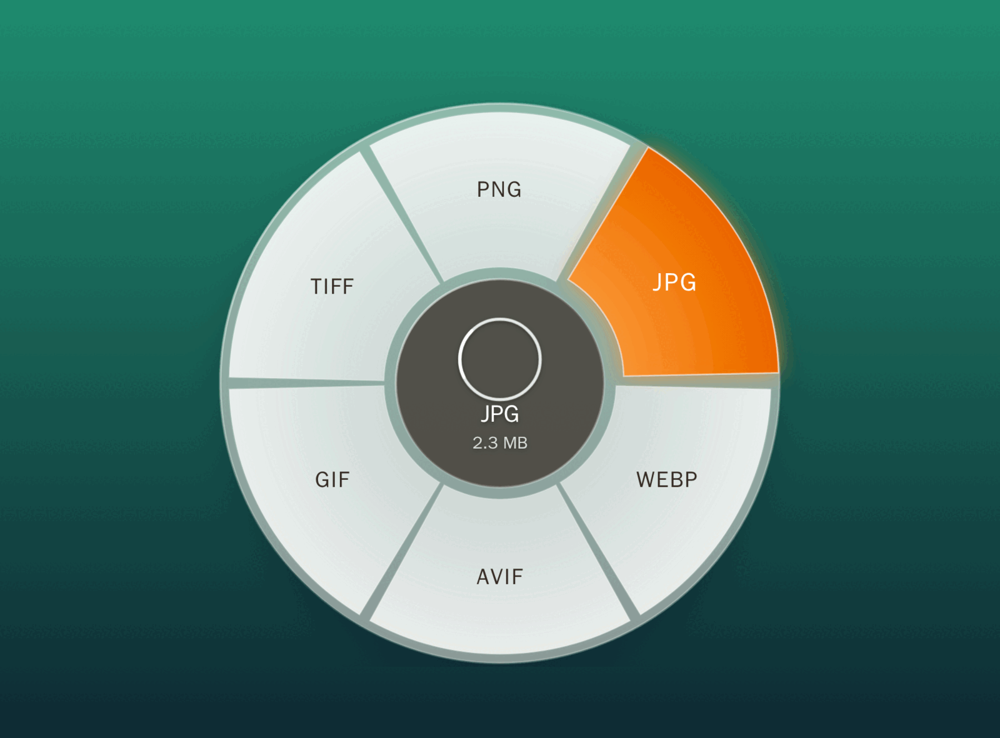

<div align="center">

# Dracon

画像・音声・動画を、自分の PC の中だけで変換する Windows 向けの小さなアプリ。

[](https://github.com/Lapius7/dracon/releases/latest)


[English](README.md) · **日本語**

</div>

<p align="center">
  
</p>

<p align="center">
  
</p>

ファイルは外部に送信されません。変換はすべて、同梱の ffmpeg でこの PC の中で行います。

## 特長

- ファイルをドラッグして **Alt** を押し、円形メニューの変換したい形式の方向へ動かして離すと変換します
- 出力は元のファイルと同じフォルダに保存されます
- 画像: PNG、JPG、WebP、AVIF、TIFF、BMP、GIF
- 音声: MP3、WAV、FLAC、Opus、M4A、OGG
- 動画: MP4、WebM、MOV、GIF、音声の抽出
- メタデータの削除（任意）
- トレイに常駐し、Windows 起動時の自動開始も選べます
- 自動アップデート: 「情報」ページの「アップデートを確認」から更新できます（GitHub Releases の署名付き更新）

## インストール

[Releases](https://github.com/Lapius7/dracon/releases/latest) から `Dracon_x.y.z_x64-setup.exe` をダウンロードして実行します。以降のバージョンはアプリの中から入れられます。

## 開発

Tauri 2、React、Rust で作られています。

```sh
pnpm install
cargo test -p dracon-core
pnpm tauri dev
```

ビルド前に、Windows 用の `ffmpeg.exe` を `src-tauri/resources/` に置いてください。置かない場合は、PATH 上の `ffmpeg` を使います。

リリースは GitHub Actions の `build` ワークフローで作られ、`TAURI_SIGNING_PRIVATE_KEY` で更新ファイルに署名します。

## ライセンス

[MIT](LICENSE) です。同梱の ffmpeg には別途そのライセンスが適用されます。
