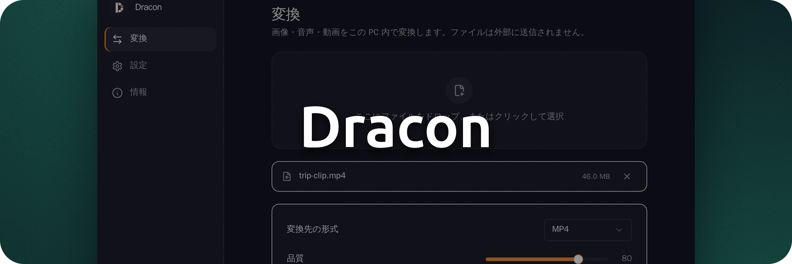
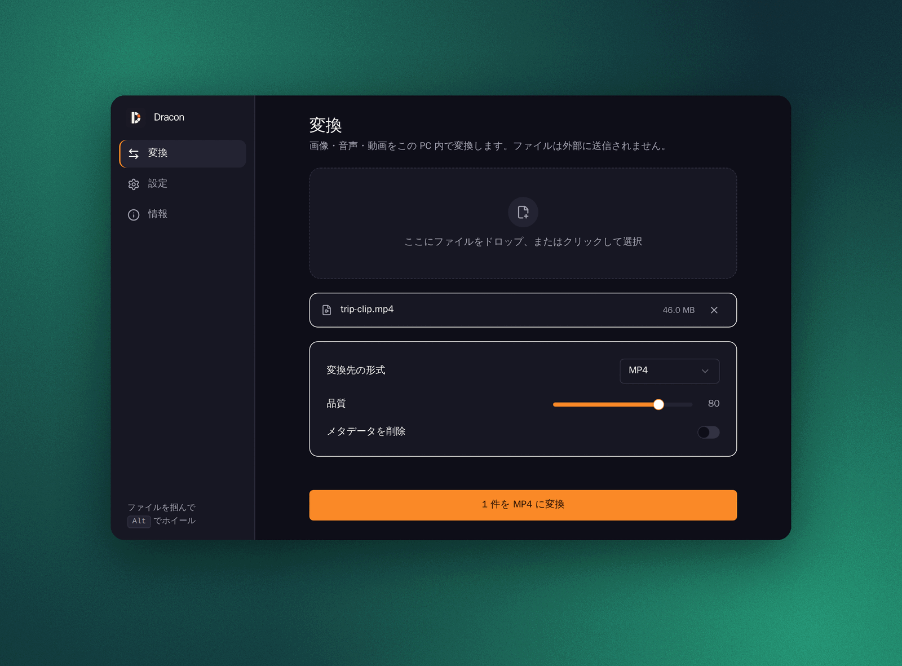
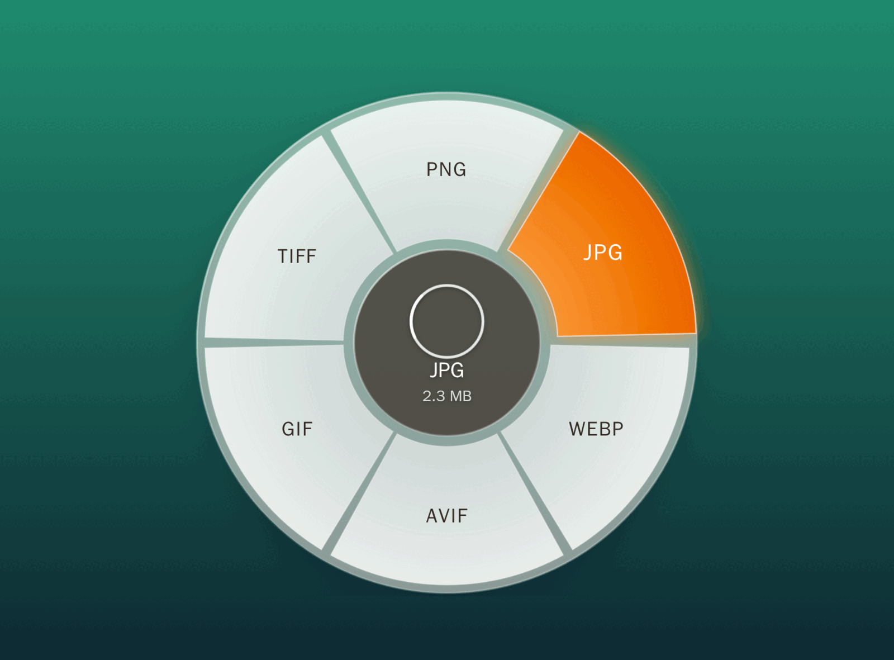

<div align="center">

<p align="center">
  
</p>

<p align="center"><b>English</b> | <a href="README.ja.md">日本語</a></p>

<h1 align="center">Dracon</h1>

<h3 align="center">Convert images, audio and video on your own PC.</h3>

<p align="center">A small Windows app. Nothing is uploaded: every conversion runs locally with a bundled ffmpeg.</p>

<p align="center">
  <a href="https://github.com/Lapius7/dracon/releases"></a>
  <a href="LICENSE"></a>
  
  <a href="https://tauri.app"></a>
  <a href="https://github.com/Lapius7/dracon/stargazers"></a>
  <a href="https://github.com/Lapius7/dracon/commits/main"></a>
</p>

<p align="center">
  <a href="#features">Features</a> · <a href="#install">Install</a> · <a href="#development">Development</a>
</p>

</div>

---

<p align="center">
  
</p>

<p align="center">
  
</p>

Nothing is uploaded. Every conversion runs locally with a bundled ffmpeg.

## Features

- Drag files, hold **Alt**, move toward a wedge of the radial menu and release to convert
- Output is saved next to the source file
- Images: PNG, JPG, WebP, AVIF, TIFF, BMP, GIF
- Audio: MP3, WAV, FLAC, Opus, M4A, OGG
- Video: MP4, WebM, MOV, GIF, and audio extraction
- Optional metadata removal
- Lives in the tray; optional start with Windows
- Auto update: **Info** page → *Check for updates* (signed updates from GitHub Releases)

## Install

Download `Dracon_x.y.z_x64-setup.exe` from [Releases](https://github.com/Lapius7/dracon/releases/latest) and run it. Later versions can be installed from inside the app.

## Development

Built with Tauri 2, React and Rust.

```sh
pnpm install
cargo test -p dracon-core
pnpm tauri dev
```

Put a Windows `ffmpeg.exe` in `src-tauri/resources/` before building. Without it, `ffmpeg` on PATH is used.

Releases are built by the `build` GitHub Actions workflow, which signs the update with `TAURI_SIGNING_PRIVATE_KEY`.

## License

[MIT](LICENSE). The bundled ffmpeg is licensed separately under its own terms.
